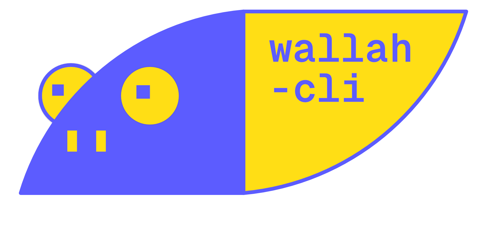
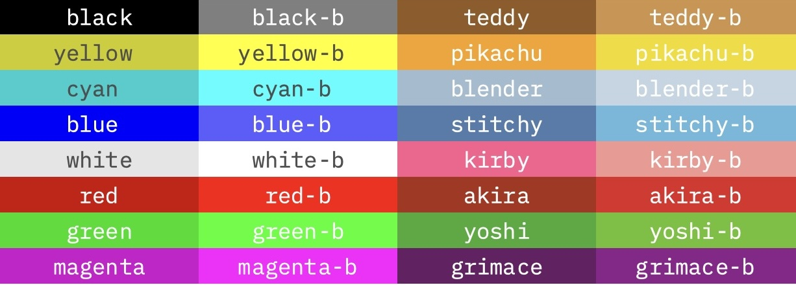
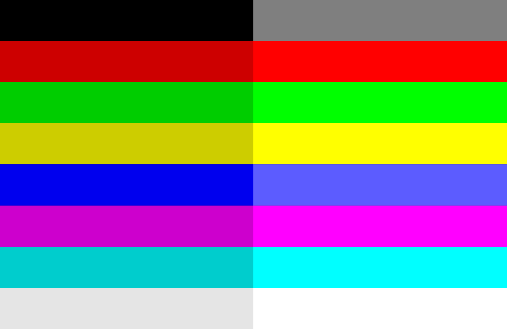
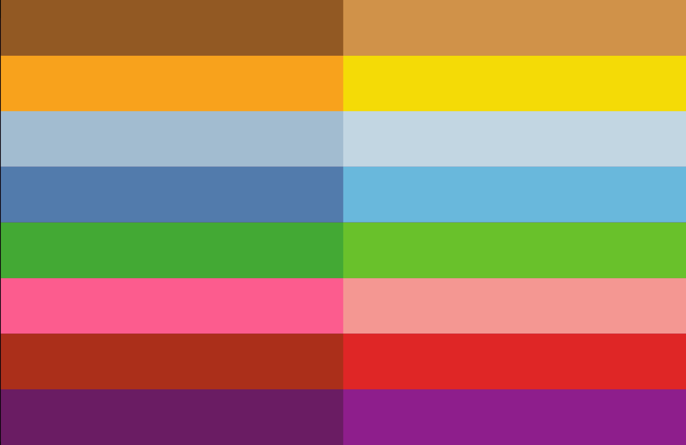

<div align="center">



</br>


</div>

A lightweight, Go-powered CLI alternative to [Top Notch](https://topnotch.app/). Choose your display and menu-bar color, set the corner style, and blend the menu bar into the notch on supported MacBooks.

### Supported Displays

1. MacBook Pro 14" and 16" (2021 or later)
2. MacBook Air 13" and 15" (2022 or later)
3. iMac 24" 4.5K (2021 or later)
4. Studio Display 27" 5K

### Installation

> This cli app requires Go 1.27.3, which its current macOS requirement is Ventura 13 or later.

You need to have Go installed. This command will compile and install the CLI tool in your system PATH.
```sh
go install github.com/stonkol/wallah@latest
```

If it is installed correctly, this will set your wallpaper to blue:
```sh
wallah blue
```

<div align="center">
</br>
<p>Colors available</p>


</div>

## Index

1. [Build yourself](#1-build-yourself)
1. [Colors included](#2-colors-included)
1. [How it works](#4-how-it-works)
1. [Roadmap](#5-roadmap)
1. [Having issues?](#5-having-issues)
1. [Contributing](#6-contributing)

---

## 1. Build yourself

### 1.1 Build the Binary

Compile all the go files:
```sh
go build
```

> [!caution] Caution
> Don't use `wall` or other name that is used for a standard Unix/Linux command.

### 1.2 Move the Binary

Move the binary to a directory in your PATH, to run the app globally:
```sh
sudo mv wallah /usr/local/bin/
sudo chmod +x /usr/local/bin/wallah # make the file executable
```

1. macOS may require explicit permission for apps (including Terminal or the compiled CLI binary) to change the wallpaper.
1. macOS may ask to accept permissions the first time your run the application.

### 1.3 Try it out

```sh
wallah -h        # show help
wallah -v        # show version
wallah -s        # to change user settings  
wallah -p        # set previous wallpaper
wallah -l        # show list of colors available

wallah blue      # set blue (#0000EE)
wallah blue-l    # set light blue (#5C5CFF)
wallah pikachu   # set pikachu color (#F8A21C)
wallah f60       # set a custom short hex color (#ff6600)
wallah ff6600    # set a custom hex color (#ff6600)

wallah -r        # set a random color
wallah -a red    # applies a red wallpaper to every desktop
```

### 1.4 Visuals

Set a wallpaper: `wallah akira`

<div align="center">

</div>

Show list: `wallah -l`

<div align="center">
</br>
<p>Colors available</p>


</div>

## 2. Colors included

Example of one of the wallpapers (bright blue):

<div align="center">

</div>

### 2.1 ANSI 16

The basic 8 colors are the dark versions. Add the `-l` suffix for light versions (`blue-l`).

`black`, `blue`, `cyan`, `green`, `magenta`, `red`, `yellow` and `white`.

<div align="center">

</div>

### 2.2 CHAR 16

Based on 8 famous characters, each with their own light and dark mode. Add the `-l` suffix for light versions (`pikachu-l`).

`akira`, `blender`, `grimace`, `kirby`, `pikachu`, `stitchy`, `teddy` and `yoshi`.

<div align="center">

</div>

## 3. Roadmap

Go to [here](dev-roadmap.md).

## 4. How it works

- Wallah generates a PNG wallpaper for the selected Mac display and color at runtime.
- The generated image uses your saved menu bar color and selected corner style: macOS 26 (round, 52 px), macOS 15 (less round, 20 px), or macOS X (square corners). The **Transparent** menu bar choice fills the menu bar with the selected wallpaper color.
- It applies the image on macOS by running AppleScript through `osascript` and Go's `os/exec` package.
- Sample wallpapers and the original design files are kept in `wallpapers` and `design-files`.
- There is a `design-files` directory with the design files (`.psd` and `.af`) used to create the wallpapers. Which you can use to create your own wallpapers, either with solid colors, gradients, or an image.
-  The corner radius for macOS 26 version is set to be 52px, while the macOS 15 is 20px.
- On first run, Wallah shows a boxed settings menu for the Mac display, menu bar color (black, white, wallpaper color, or custom), and screen corner style. Use the arrow keys and Enter or Right to expand an item; select a value and then choose **Save and exit** or press `q` to save. Wallah saves these settings for future runs. Run `wallah -s` or `wallah --settings` to change them later. For a custom menu bar color, enter a listed color name or a hex value such as `#223344`.

## 5. Having issues

#### 5.1 Only changed on one desktop?

On newer macOS versions (Ventura, Sonoma), wallpaper management changed:
The wallpaper might only change on the current desktop/space.
You might need to set wallpaper for each desktop separately.

#### 5.2 Running the AppleScript manually

Test the AppleScript works with your wallpaper manually in the Terminal:

```sh
osascript -e 'tell application "System Events" to set picture of every desktop to POSIX file "/absolute/path/to/image.jpg"'
```

#### 5.3 Run the command as the logged-in user

If you run your Go program as root or via sudo, the AppleScript may run as root and fail to change the wallpaper for the logged-in user.
Make sure you run the CLI as the current logged-in user.


## 6. Contributing

Welcome to make a pull request or add an issue, but before, please read the README.md before contributing. 😀
