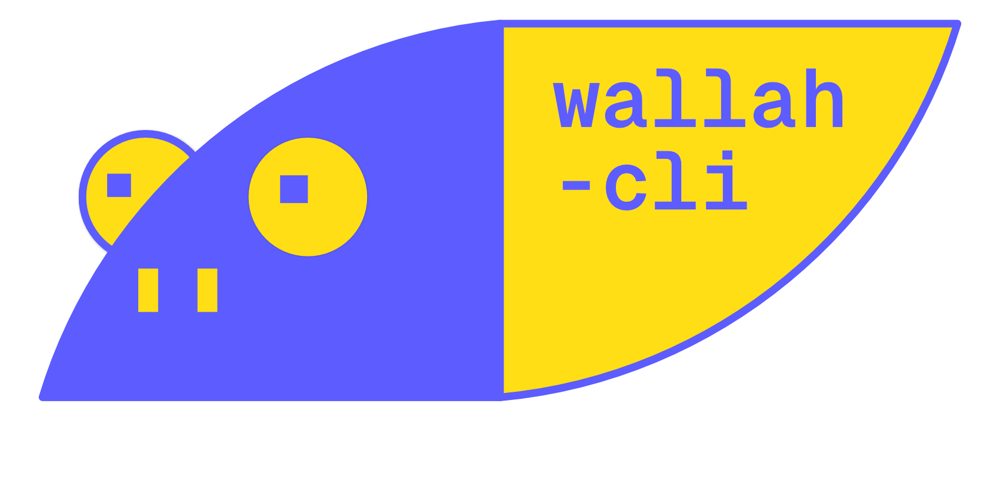
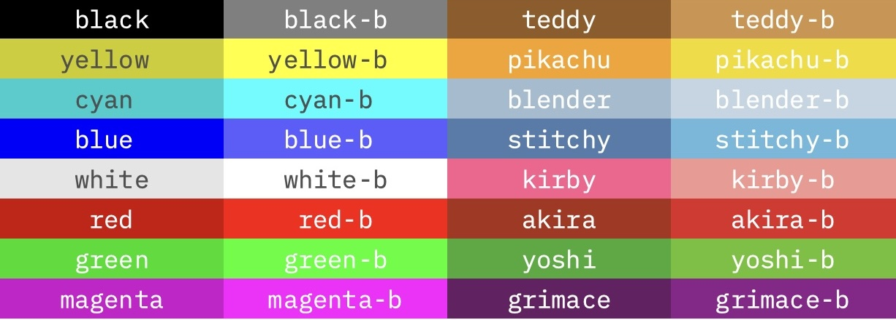
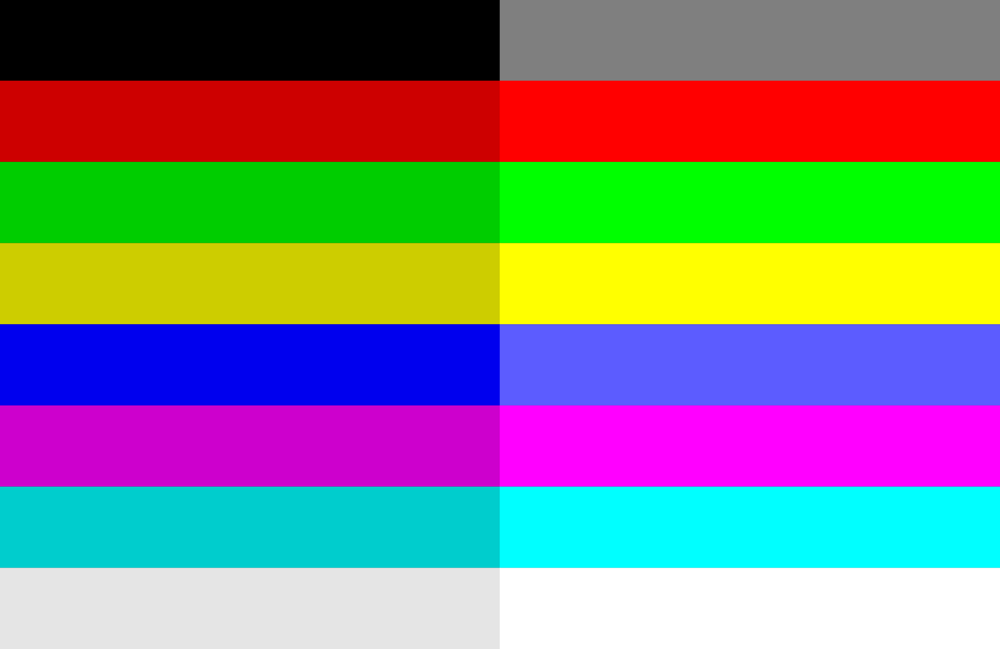
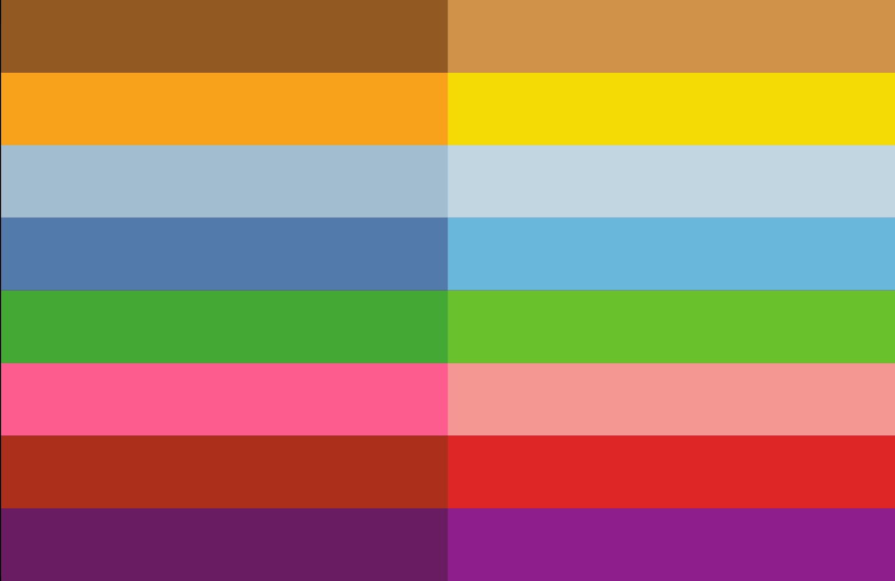

<div align="center">



</br>


[](https://goreportcard.com/report/github.com/stonkol/wall-cli)

</div>

wallah-cli is a CLI which you can change your macOS wallpaper, in which the menu bar part is black, in order to hide that ugly notch. Furthermore, it is less distracting if you have the menu bar auto-hide enabled.

It is a minimal alternative to the app [Top Notch](https://topnotch.app/), and it is inspired by [removethenotch](removethenotch.com).

### Installation

You need to have Go installed. This command will compile and install the CLI tool in your system PATH.
```sh
go install github.com/stonkol/wallah@latest
```

If it is installed correctly, this will set your wallpaper to blue:
```sh
wallah blue
```

<div align="center">
</br>
<p>Colors available</p>


</div>

## Index

1. [Build yourself](#1-build-yourself)
1. [Colors included](#2-colors-included)
1. [How it works](#4-how-it-works)
1. [Roadmap](#5-roadmap)
1. [Having issues?](#5-having-issues)
1. [Contributing](#6-contributing)

---

## 1. Build yourself

### 1.1 Build the Binary

Compile all the go files:
```sh
go build
```

> [!caution] Caution
> Don't use `wall` or other name that is used for a standard Unix/Linux command.

### 1.2 Move the Binary

Move the binary to a directory in your PATH, to run the app globally:
```sh
sudo mv wallah /usr/local/bin/
sudo chmod +x /usr/local/bin/wallah # make the file executable
```

1. macOS may require explicit permission for apps (including Terminal or the compiled CLI binary) to change the wallpaper.
1. macOS may ask to accept permissions the first time your run the application.

### 1.3 Try it out

```sh
wallah -h        # show help
wallah -v        # show version

wallah -l        # show list of colors available
wallah -r        # set a random color
wallah blue      # set blue (#0000EE)
wallah blue-b    # set bright blue (#5C5CFF)
wallah pikachu   # set pikachu color (#F8A21C)

wallah -p        # set previous wallpaper
wallah -a red    # applies a red wallpaper to every desktop
```

### 1.4 Visuals

Set a wallpaper: `wallah akira`

<div align="center">

</div>

Show list: `wallah -l`

## 2. Colors included

Example of one of the wallpapers (bright blue):

<div align="center">

</div>

### 2.1 ANSI 16

The basic 8 colors, by default, is the dark mode version. Add `b-` prefix for bright (light) versions (`b-blue`).

`black`, `blue`, `cyan`, `green`, `magenta`, `red`, `yellow` and `white`.

<div align="center">

</div>

### 2.2 CHAR 16

Based on 8 famous characters, each with their own light and dark mode. Add `b-` prefix for bright (light) versions (`b-pikachu`).

`akira`, `blender`, `grimace`, `kirby`, `pikachu`, `stitchy`, `teddy` and `yoshi`.

<div align="center">

</div>

## 3. Roadmap

Go to [here](dev-roadmap.md).

## 4. How it works

- Using `osascript` command to change the color of the wallpaper on macOS.
- It runs AppleScript from Go using the `os/exec` package.
- All the default wallpapers are located in the `wallpapers` directory.
- There is a `design-files` directory with the design files (`.psd` and `.afdesign`) used to create the wallpapers. Which you can use to create your own wallpapers, either with solid colors, gradients, or an image.

## 5. Having issues

#### 5.1 Only changed on one desktop?

On newer macOS versions (Ventura, Sonoma), wallpaper management changed:
The wallpaper might only change on the current desktop/space.
You might need to set wallpaper for each desktop separately.

#### 5.2 Running the AppleScript manually

Test the AppleScript works with your wallpaper manually in the Terminal:

```sh
osascript -e 'tell application "System Events" to set picture of every desktop to POSIX file "/absolute/path/to/image.jpg"'
```

#### 5.3 Run the command as the logged-in user

If you run your Go program as root or via sudo, the AppleScript may run as root and fail to change the wallpaper for the logged-in user.
Make sure you run the CLI as the current logged-in user.


## 6. Contributing

Welcome to make a pull request or add an issue, but before, please read the README.md before contributing. 😀
